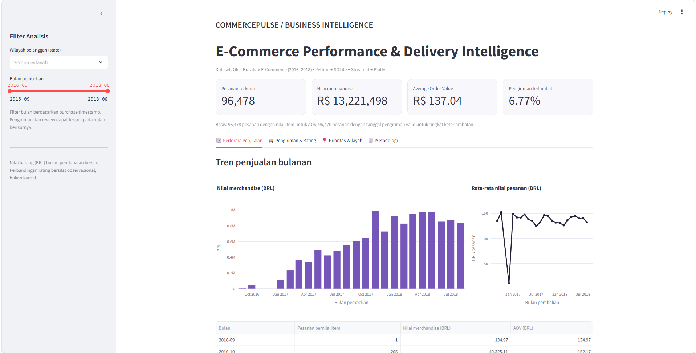

# CommercePulse
### E-Commerce Revenue & Customer Experience Intelligence

**SQL • Python • Statistics • Business Analytics • Streamlit**

CommercePulse is an end-to-end data science portfolio case study investigating e-commerce sales performance, delivery reliability, and customer satisfaction using historical Brazilian marketplace data.

The project combines relational SQL analysis, statistical inference, regional prioritization, and an interactive Streamlit dashboard to support evidence-based business decisions.

> **Project status:** Completed portfolio case study with SQL analyses, statistical testing, dashboard, executive summary, and a basic regression test. This is an independent educational analysis—not an official Olist engagement or a production system.

## Dashboard Preview



The dashboard is designed to run **locally**. No publicly hosted live demo is currently provided.

## Business Questions

1. How does merchandise value and average order value change over time?
2. What percentage of delivered orders arrive after their estimated delivery date?
3. How does customer satisfaction differ between late and on-time deliveries?
4. Does the observed relationship vary with the number of days delayed?
5. Which customer regions should be prioritized for further operational investigation?

## Key Results

Results below were calculated from the Olist dataset using the project SQL scripts and Python analysis. Unless otherwise noted, figures are descriptive and refer to historical orders.

| Metric | Result |
|---|---:|
| Total orders in source orders table | 99,441 |
| Delivered orders shown in dashboard | 96,478 |
| Total merchandise value for delivered orders | R$ 13,221,498 (rounded) |
| Average order value (merchandise-based proxy) | R$ 137.04 |
| Late delivery rate among orders with valid delivery dates | 6.77% |
| Delivered orders with valid delivery dates and review scores | 95,824 |

### Finding 1 — Late Delivery and Low Customer Ratings

A **low rating** is defined as a review score of 1 or 2 (out of 5). Among eligible delivered orders with reviews:

| Delivery group | Reviewed orders | Low ratings | Low-rating rate |
|---|---:|---:|---:|
| On time or early | 89,443 | 8,290 | 9.27% |
| Late | 6,381 | 3,982 | 62.40% |

- **Absolute difference:** 53.14 percentage points.
- **Risk ratio (descriptive):** 6.73×.
- **95% confidence interval for the difference:** 51.93–54.34 percentage points, using a normal approximation.
- **Chi-square test:** Strong evidence against independence between delivery status and low-rating category (extremely small p-value).

**Interpretation:** In this dataset, late deliveries are strongly *associated* with low review scores. This is **not evidence of a causal effect**; location, sellers, products, customer characteristics, missing reviews, and other factors may contribute.

### Finding 2 — Severity of Delay Matters

| Delivery timing | Share of reviewed orders with low ratings |
|---|---:|
| At the estimated date | 12.42% |
| 1–3 days late | 32.13% |
| 4–7 days late | 67.62% |
| 8+ days late | 79.29% |

The observed low-rating rate increases across delay-severity groups, motivating more detailed operational investigation.

### Finding 3 — Regional Operational Priorities

Regions are ranked by **the number of late, low-rated reviewed orders**, rather than by percentage alone.

| Customer state | Late orders with low ratings | Late-delivery share among reviewed orders |
|---|---:|---:|
| Rio de Janeiro (RJ) | 1,064 | 11.92% |
| São Paulo (SP) | 970 | 4.44% |
| Minas Gerais (MG) | 298 | 4.47% |
| Bahia (BA) | 231 | 11.89% |

**Suggested investigation priority:** RJ has a high volume of late, low-rated orders alongside a relatively high observed delay rate. SP also has a substantial case volume because of its larger customer base. These figures help prioritize investigation; they do not estimate the impact of a proposed intervention.

### Finding 4 — Monthly Merchandise Performance

Among delivered orders, **November 2017** had the highest monthly merchandise value in the SQL output, approximately **R$ 987,765**.

*Merchandise value is the sum of item prices and is not Olist's company revenue, profit, or a comprehensive financial GMV metric.*

## Recommended Business Actions

1. **Investigate delivery operations in RJ and SP.** Examine carriers, seller fulfillment, routes, and geographic factors before choosing interventions.
2. **Monitor delay severity.** Track orders exceeding estimated delivery dates, with separate monitoring for 1–3, 4–7, and 8+ day delays.
3. **Evaluate proactive customer communication.** Test delay notifications or customer-service outreach; measure outcomes rather than assuming they improve ratings.
4. **Establish recurring regional KPIs.** Review late-delivery rate, low-rating rate, and absolute case volume together.

These are **analytical recommendations**, not actions already implemented or measured for business impact.

## Dashboard Features

Built with **Streamlit + Plotly**:

- **Sales performance:** Delivered orders, merchandise value, AOV, and monthly trends.
- **Delivery and ratings:** Late-delivery rate, low-rating proportions, risk ratio, confidence interval, and delay-severity comparison.
- **Regional prioritization:** State-level operational case counts and rates.
- **Methodology:** Metric definitions, sample restrictions, and limitations.
- **Filters:** Customer state and purchase-month range; metrics recalculate for the selected subset.
- **Exports:** Selected summary tables can be downloaded as CSV.

## Tech Stack

| Area | Tools and techniques |
|---|---|
| Data storage and querying | SQLite, SQL, JOINs, CTEs, window functions |
| Data analysis | Python, pandas, NumPy |
| Statistical analysis | SciPy, chi-square test, risk difference, risk ratio, confidence interval |
| Visualization | Streamlit, Plotly |
| Quality assurance | SQL data-quality checks, Python `unittest`, synthetic fixture |

## Dataset

**Source:** [Brazilian E-Commerce Public Dataset by Olist — Kaggle](https://www.kaggle.com/datasets/olistbr/brazilian-ecommerce)  
**Period:** Historical transactions from 2016–2018  
**License published with the dataset:** CC BY-NC-SA 4.0

The following four source files are required:

```
olist_orders_dataset.csv
olist_order_items_dataset.csv
olist_customers_dataset.csv
olist_order_reviews_dataset.csv
```

Raw data and generated SQLite databases are **not distributed in this repository**. Download the dataset from its original publisher and respect its license.

## Project Structure

```
CommercePulse/
├── dashboard/
│   ├── __init__.py
│   ├── analytics.py
│   └── app.py
├── data/
│   ├── raw/                    # Downloaded CSV files (Git-ignored)
│   └── processed/              # Generated local SQLite DB (Git-ignored)
├── docs/
│   ├── images/
│   │   └── dashboard-overview.png
│   ├── dashboard_setup.md
│   ├── executive_summary.md
│   ├── project_brief.md
│   └── roadmap_14_days.md
├── sql/
│   ├── 01_data_quality.sql
│   ├── 02_revenue_kpis.sql
│   ├── 03_delivery_satisfaction.sql
│   ├── 04_delivery_delay_buckets.sql
│   ├── 05_customer_state_analysis.sql
│   └── 06_state_prioritization.sql
├── src/
│   ├── effect_size.py
│   ├── load_data.py
│   ├── run_queries.py
│   └── stats_delivery.py
├── tests/
│   └── test_analytics.py
├── requirements.txt
├── requirements_dashboard.txt
└── README.md
```

## How to Run Locally

**Prerequisites:** Python 3.12, Git, and the four Olist CSV files.

**1. Clone the repository**

```bash
git clone https://github.com/Ghoizy/commercepulse.git
cd commercepulse
```

**2. Download the data**

Download the [Olist dataset](https://www.kaggle.com/datasets/olistbr/brazilian-ecommerce), extract it, and place the four required CSV files in `data/raw/` **without renaming them**.

**3. Install dependencies (Windows / PowerShell)**

```powershell
py -3.12 -m pip install -r requirements.txt
py -3.12 -m pip install -r requirements_dashboard.txt
```

**4. Build the local SQLite database**

```powershell
py -3.12 src/load_data.py
```

This generates `data/processed/commercepulse.sqlite`.

**5. Execute SQL reports and statistical tests**

```powershell
py -3.12 src/run_queries.py
py -3.12 src/stats_delivery.py
py -3.12 src/effect_size.py
```

`src/effect_size.py` demonstrates the interval calculation using the full-dataset counts recorded during this analysis; it does not automatically refresh those counts from SQLite.

**6. Launch the dashboard**

```powershell
py -3.12 -m streamlit run dashboard/app.py
```

Open the local URL displayed in your terminal (usually `http://localhost:8501`). Keep the Streamlit process running while using the app.

**7. Run the regression test**

```powershell
py -3.12 -m unittest discover -s tests -v
```

This repository currently includes a focused synthetic-fixture regression test for order-level aggregation, review selection, and dashboard metrics. It does not provide comprehensive test coverage or prove production readiness.

## Analytical Definitions and Limitations

- **Unit of analysis:** One delivered order for order-level KPIs and delivery analysis. Item prices are aggregated to order level before combining with reviews.
- **Merchandise value:** Sum of valid nonnegative `order_items.price` for delivered orders; excludes shipping, taxes, fees, refunds, and costs.
- **AOV proxy:** Merchandise value divided by the count of delivered orders with item-price data.
- **Late delivery:** Actual delivery *calendar date* later than estimated delivery calendar date.
- **Low rating:** Score 1 or 2, among orders with a valid review (1–5).
- **Multiple reviews:** Select one review per order, using the latest `review_creation_date` and then `review_id`.
- **Missingness:** Not all orders have usable delivery timestamps, order-item data, or reviews; sample sizes differ across KPIs.
- **Statistical inference:** Chi-square and normal-approximation confidence intervals describe an association under modeling assumptions. They do not establish causation.
- **External validity:** This is a historical Brazilian dataset; conclusions are not automatically transferable to other markets or the current period.
- **Dataset restrictions:** Follow publisher license terms; the repository includes source code and documentation, not raw customer-order records.

## Documentation

- [Executive business report](docs/executive_summary.md)
- [Dashboard setup guide](docs/dashboard_setup.md)
- [Project brief](docs/project_brief.md)
- [Original implementation roadmap](docs/roadmap_14_days.md)

## Author

**Ghoizy** — Data Science & Machine Learning portfolio  
[GitHub Profile](https://github.com/Ghoizy)

---

**Disclaimer:** CommercePulse is an independent portfolio project based on a publicly available dataset. It is not affiliated with, endorsed by, or a consulting engagement for Olist.